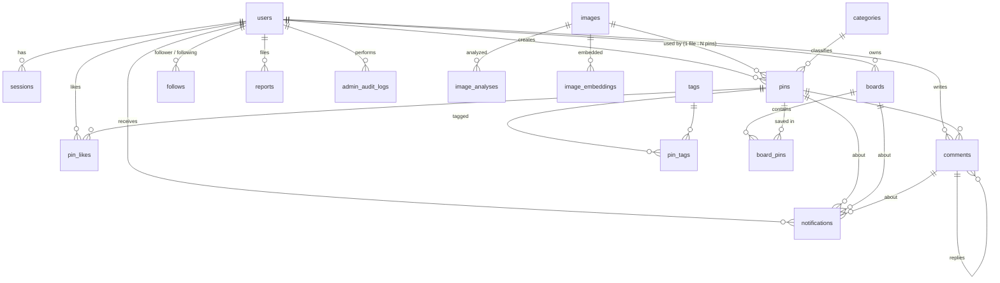

# Mosaic 데이터베이스 설계

- DBMS: **PostgreSQL 14+** (`bit_count` 사용, 개발/검증은 17) — 확장 모듈 불필요
- ORM / 마이그레이션: Drizzle ORM 0.45, drizzle-kit (`src/db/schema.ts` → `drizzle/*.sql`)
- 마이그레이션: `0000_init.sql`(18개 테이블, 11개 enum, 42개 인덱스), `0001_seed_categories.sql`(기본 카테고리 16개)

## 1. ERD



## 2. 핵심 설계 결정

| 결정 | 이유 |
| --- | --- |
| **images(물리 파일) ↔ pins(게시물) 분리** | 같은 파일은 SHA-256 기준으로 한 번만 저장. 원본/중간/썸네일 키·크기·대표색을 이미지 단위로 관리하고, 여러 사용자의 핀이 하나의 파일을 참조할 수 있음 |
| `bigint identity` PK | 인덱스가 작고 조인이 빠르며, 삽입 순서 = 시간 순서라 최신 피드를 `id DESC` 키셋으로 처리 |
| 비정규화 카운터 | like/save/comment/share/pin/follower/following/board pin 수를 트랜잭션 내에서 갱신 → 목록에서 COUNT 제거 |
| 생성 컬럼(STORED) | `pins.search_vector`(tsvector), `pins.popularity`, `images.phash_a~d` 를 DB 가 자동 유지 |
| 부분 인덱스 | 공개·활성 핀만 대상으로 하는 피드 인덱스, 미읽음 알림, 대기 작업, 대기 신고 중복 방지 |
| `timestamptz(3)` | JS Date(ms)와 정확히 왕복 → 시간 기반 키셋 커서 정확성 |
| 비공개 리소스 404 | 권한 없는 접근 시 존재 여부를 노출하지 않음 (서비스 계층에서 강제) |
| AI 확장 테이블 선반영 | `image_analyses`, `image_embeddings`, `pin_tags.source/confidence`, `jobs` |

## 3. Enum

| 이름 | 값 |
| --- | --- |
| user_role | user, admin |
| user_status | active, suspended |
| visibility | public, private |
| pin_status | active, hidden |
| tag_source | user, ai |
| notification_type | follow, like, comment, save, system |
| report_target | pin, comment, user, board |
| report_reason | spam, nudity, violence, hate, harassment, copyright, misinformation, other |
| report_status | pending, resolved, dismissed |
| analysis_status | pending, processing, completed, failed, skipped |
| job_status | pending, running, completed, failed |

## 4. 테이블

### users
| 컬럼 | 타입 | 제약/기본값 | 설명 |
| --- | --- | --- | --- |
| id | bigint identity | PK | |
| email | varchar(255) | NOT NULL, UNIQUE | 소문자 정규화 |
| username | varchar(30) | NOT NULL, UNIQUE, CHECK `^[a-z0-9_]{3,30}$` | 프로필 URL `/u/{username}` |
| display_name | varchar(50) | NOT NULL | |
| password_hash | text | NOT NULL | `scrypt$N$r$p$salt$hash` |
| bio | varchar(500) | | |
| website_url | varchar(2048) | | http/https 만 허용 |
| avatar_key | text | | 저장소 키 (320px WebP) |
| role | user_role | `user` | |
| status | user_status | `active` | 정지 시 로그인 차단·콘텐츠 비노출 |
| follower_count / following_count / pin_count | int | 0 | 비정규화 카운터 |
| last_login_at, created_at, updated_at | timestamptz(3) | | |

인덱스: `users_email_uq`, `users_username_uq`, `users_username_prefix_idx (username varchar_pattern_ops)`, `users_created_idx`

### sessions
| 컬럼 | 타입 | 설명 |
| --- | --- | --- |
| id | varchar(64) PK | 세션 토큰의 **SHA-256** (원문은 쿠키에만) |
| user_id | bigint FK → users ON DELETE CASCADE | |
| expires_at | timestamptz(3) | 기본 30일 |
| user_agent, ip | varchar | 감사용 |

인덱스: `sessions_user_idx`, `sessions_expires_idx`

### categories
`id int identity PK`, `slug varchar(50) UNIQUE`, `name`, `description`, `sort_order` — 마이그레이션으로 16개 기본 카테고리 삽입

### images (물리 이미지 파일)
| 컬럼 | 타입 | 설명 |
| --- | --- | --- |
| id | bigint identity PK | |
| sha256 | char(64) UNIQUE | 업로드 원본 바이트 해시 — **정확 중복 판정** |
| phash | bigint | 64bit dHash — **유사(근접) 중복 판정** |
| phash_a/b/c/d | int GENERATED (phash 의 16bit 청크) | Multi-Index Hashing 인덱스 |
| storage_driver | varchar(16) | `local` / `s3` (드라이버 변경 후에도 기존 파일 서빙) |
| original_key / medium_key / thumb_key | text | **원본·중간(1200px)·썸네일(474px) 분리 저장** |
| mime_type, format | varchar | 원본 형식 |
| width, height | int | 원본(방향 보정 후) 해상도 |
| medium_width/height, thumb_width/height | int | 변형 크기 |
| size_bytes | int | 원본 크기 |
| dominant_color | varchar(7) | 로딩 플레이스홀더 색 |
| is_animated | bool | GIF/애니메이션 WebP |
| uploaded_by | bigint FK → users ON DELETE SET NULL | 최초 업로더 |
| analysis_status | analysis_status | AI 분석 진행 상태 |

인덱스: `images_sha256_uq`, `images_phash_{a,b,c,d}_idx`

> **Multi-Index Hashing**: 64bit 해시를 16bit 청크 4개로 나누면 전체 해밍 거리가 t 이하일 때 적어도 한 청크의 거리는 ⌊t/4⌋ 이하입니다(비둘기집 원리). 기본값 t=6 이면 청크당 반경 1 이내 값(17개)을 `IN` 조건으로 인덱스 조회해 후보를 소수로 줄인 뒤 `bit_count((phash # $h)::bit(64)) <= t` 로 정밀 비교합니다 → 테이블 스캔 없이 t ≤ 7 까지 누락 없이 탐색.
>
> **해시 계산**: 압축 원본에서 바로 축소하면 JPEG/WebP 디코더 단계 축소(shrink-on-load) 때문에 같은 픽셀이라도 형식별로 해시가 달라지므로, 원시 RGB 로 디코딩한 뒤 9×8 로 축소하고 휘도를 직접 계산합니다. 측정 결과 형식 변환(PNG) 거리 0, 리사이즈·재압축 사본은 거리 ≤6 에서 93~98% 감지, 무관한 이미지 오탐 약 0.2%.

### image_analyses (AI/분석기 결과)
`id`, `image_id FK CASCADE`, `analyzer`, `model_version`, `status`, `labels jsonb [{name, confidence}]`, `caption`, `colors jsonb [{hex, ratio, name}]`, `raw jsonb`, `error`, `created_at`, `completed_at`
— UNIQUE `(image_id, analyzer)` → 분석기별 upsert

### image_embeddings (유사도 검색 확장용)
`PK (image_id, model)`, `dimensions`, `embedding real[]` — pgvector 도입 시 `vector(N)` + HNSW 인덱스로 전환 (ARCHITECTURE.md §10.2)

### pins (게시물)
| 컬럼 | 타입 | 설명 |
| --- | --- | --- |
| id | bigint identity PK | |
| author_id | FK → users ON DELETE CASCADE | |
| image_id | FK → images ON DELETE **RESTRICT** | 사용 중인 파일 삭제 방지 |
| title | varchar(100) NOT NULL | |
| description | text | 최대 1000자(애플리케이션 검증) |
| source_url / source_domain | varchar | 원본 URL 과 표시용 도메인 |
| category_id | FK → categories ON DELETE SET NULL | |
| visibility | visibility | public / private |
| status | pin_status | active / hidden(관리자 숨김) |
| tags_text | text | 검색용 비정규화 태그 문자열 |
| search_ngrams | text | 한글/CJK 바이그램 (애플리케이션 계산) |
| search_vector | tsvector **GENERATED** | 제목 A, 태그 A, 설명 B, 바이그램 C |
| like_count / save_count / comment_count / share_count | int | 카운터 |
| popularity | int **GENERATED** | like + save×2 + comment + share |
| created_at, updated_at | timestamptz(3) | |

인덱스:
| 이름 | 정의 | 용도 |
| --- | --- | --- |
| pins_author_image_uq | UNIQUE (author_id, image_id) | 같은 사용자의 동일 이미지 중복 핀 방지 (DB 레벨) |
| pins_image_idx | (image_id) | 중복 검사·고아 이미지 정리 |
| pins_created_idx | (created_at) | 관리자 일별 통계 |
| pins_author_idx | (author_id, id DESC) | 프로필 핀 목록 |
| pins_public_latest_idx | (id DESC) WHERE active AND public | 최신 피드 |
| pins_public_popular_idx | (popularity DESC, id DESC) WHERE active AND public | 인기 피드 |
| pins_category_idx | (category_id, id DESC) WHERE active AND public | 카테고리 필터 |
| pins_search_idx | GIN (search_vector) | 전문 검색 |

### tags / pin_tags
- `tags`: `id`, `name varchar(50) UNIQUE`(정규화: 소문자, `#` 제거, 공백→`_`), `usage_count`
  인덱스: `tags_name_uq`, `tags_name_prefix_idx (varchar_pattern_ops)` — 자동완성, `tags_usage_idx` — 인기 태그
- `pin_tags`: `PK (pin_id, tag_id)`, `source tag_source`(user/ai), `confidence real`, 인덱스 `pin_tags_tag_idx (tag_id, pin_id)`

### boards / board_pins
- `boards`: `id`, `owner_id FK CASCADE`, `name varchar(50)`, `description`, `visibility`, `cover_pin_id FK → pins SET NULL`, `pin_count`, `created_at`, `updated_at`
  인덱스: `boards_owner_name_uq UNIQUE (owner_id, lower(name))` — 사용자별 보드 이름 중복 방지, `boards_owner_idx (owner_id, updated_at DESC)`
- `board_pins`: `PK (board_id, pin_id)` — **한 핀을 여러 보드에 저장**, `created_at`(저장 시각)
  인덱스: `board_pins_pin_idx (pin_id)` — 저장 여부/공동 저장 추천, `board_pins_board_created_idx (board_id, created_at DESC, pin_id DESC)` — 보드 핀 목록 키셋

### pin_likes / comments / follows
- `pin_likes`: `PK (user_id, pin_id)`, 인덱스 `(pin_id)`, `(user_id, created_at DESC, pin_id DESC)` — 좋아요한 핀 목록
- `comments`: `id`, `pin_id FK CASCADE`, `author_id FK CASCADE`, `parent_id FK → comments CASCADE`(답글 확장), `body varchar(1000)`, 인덱스 `(pin_id, id)`, `(author_id)`
- `follows`: `PK (follower_id, following_id)`, CHECK `follower_id <> following_id`, 인덱스 `(following_id, created_at DESC)`, `(follower_id, created_at DESC)`

### notifications
`id`, `recipient_id FK CASCADE`, `actor_id FK CASCADE`, `type`, `pin_id / board_id / comment_id`(각 FK CASCADE), `message`(system), `read_at`, `created_at`
인덱스: `notifications_recipient_idx (recipient_id, id DESC)`, `notifications_unread_idx (recipient_id) WHERE read_at IS NULL`
— 좋아요 취소·언팔로우·저장 취소 시 해당 알림을 회수합니다.

### reports / admin_audit_logs
- `reports`: `id`, `reporter_id FK SET NULL`, `target_type`, `target_id`, `reason`, `details`, `status`, `resolved_by`, `resolution_note`, `resolved_at`
  인덱스: `(status, id DESC)`, `(target_type, target_id)`, `reports_pending_uq UNIQUE (reporter_id, target_type, target_id) WHERE status='pending'` — 중복 신고 방지
- `admin_audit_logs`: `id`, `admin_id FK SET NULL`, `action`, `target_type`, `target_id`, `details jsonb`, `created_at`

### jobs (백그라운드 작업 큐)
`id`, `type`, `payload jsonb`, `status`, `attempts`, `max_attempts`, `run_at`, `locked_at`, `last_error`, `created_at`, `completed_at`
인덱스: `jobs_pending_idx (run_at, id) WHERE status='pending'` — `FOR UPDATE SKIP LOCKED` 점유

## 5. 데이터 정합성

- 카운터 변경은 모두 원본 행 변경과 **같은 트랜잭션**에서 수행 (`INSERT … ON CONFLICT DO NOTHING RETURNING` 으로 실제 변경이 있을 때만 증감 → 멱등).
- 핀 삭제: 태그 사용 수 차감 → 저장된 보드의 pin_count 차감 → 핀 삭제(연관 행 CASCADE) → 작성자 pin_count 차감 → 고아 이미지 정리.
- 회원 탈퇴/관리자 삭제(`purgeUser`): 다른 사용자 엔티티의 카운터(좋아요·댓글·팔로우·저장·태그)를 먼저 보정한 뒤 사용자 삭제(CASCADE).
- 검증 쿼리(테스트에서 사용): 모든 카운터가 실제 행 수와 일치하는지 확인 — 통합 테스트 반복 실행 후에도 불일치 0건.

## 6. 실행 계획 검증

실제 서비스 쿼리 형태로 `EXPLAIN` 하여 의도한 인덱스가 사용되는지 확인했습니다 (`SET enable_seqscan = off`).

| 쿼리 | 실행 계획 |
| --- | --- |
| 최신 피드 (키셋) | Index Only Scan using `pins_public_latest_idx` (정렬 단계 없음) |
| 인기 피드 (키셋, row 비교) | Index Only Scan using `pins_public_popular_idx` |
| 카테고리 필터 | Index Only Scan using `pins_category_idx` |
| 전문 검색 (접두 + 바이그램) | Bitmap Index Scan on `pins_search_idx` (GIN) |
| 유사 이미지 (MIH) | Bitmap Index Scan on `images_phash_{a,b,c,d}_idx` → BitmapOr |
| 보드 핀 (키셋) | Index Only Scan using `board_pins_board_created_idx` |
| 미읽음 알림 수 | Bitmap Index Scan on `notifications_unread_idx` (부분 인덱스) |
| 태그 자동완성 | Index Scan using `tags_name_prefix_idx` (varchar_pattern_ops) |

## 7. 마이그레이션 워크플로

```bash
# 1) src/db/schema.ts 수정
npm run db:generate -- --name add_something   # drizzle/000N_add_something.sql 생성
# 2) 검토 후 적용
npm run db:migrate
# 데이터 마이그레이션/확장 설치 등 수동 SQL 이 필요하면
npx drizzle-kit generate --custom --name my_custom_sql
```
